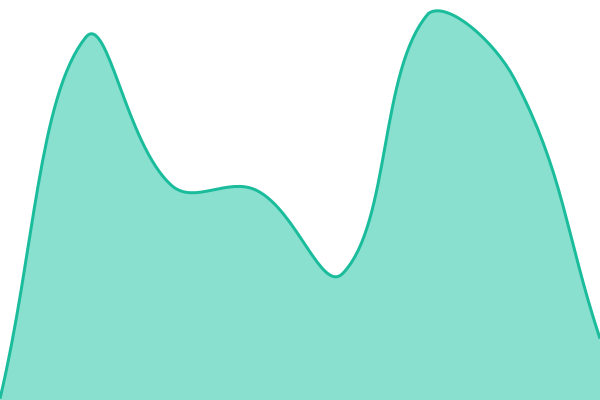

# Estado de Carmiña Villegas

This repository contains the open-source uptime monitor and status page for [Antisacsor S.A.S](www.antisacsor.com), powered by [Upptime](https://github.com/upptime/upptime).

<!--start: status pages-->
<!-- This summary is generated by Upptime (https://github.com/upptime/upptime) -->
<!-- Do not edit this manually, your changes will be overwritten -->
<!-- prettier-ignore -->
| URL | Status | History | Response Time | Uptime |
| --- | ------ | ------- | ------------- | ------ |
|  [Tienda online](https://www.carminavillegas.com/) | En línea | [tienda.yml](https://github.com/Antisacsor/cvillegas-status/commits/HEAD/history/tienda.yml) | 

 500ms
     
 | 

<a href="https://status.carminavillegas.com/history/tienda">100.00%</a>
    

|  [Formularios (API)](https://middle-end.carminavillegas.com/health) | En línea | [api-formularios.yml](https://github.com/Antisacsor/cvillegas-status/commits/HEAD/history/api-formularios.yml) | 

 230ms
     
 | 

<a href="https://status.carminavillegas.com/history/api-formularios">99.19%</a>
    

|  [Lista de deseos (API)](https://middle-end.www.carminavillegas.com/health) | En línea | [api-wishlist.yml](https://github.com/Antisacsor/cvillegas-status/commits/HEAD/history/api-wishlist.yml) | 

 230ms
     
 | 

<a href="https://status.carminavillegas.com/history/api-wishlist">99.24%</a>
    

|  [Datos de clientes (VTEX)](https://middle-end.carminavillegas.com/health/deep) | En línea | [datos.yml](https://github.com/Antisacsor/cvillegas-status/commits/HEAD/history/datos.yml) | 

 505ms
     
 | 

<a href="https://status.carminavillegas.com/history/datos">99.28%</a>
    

|  [Verificación anti-bots (captcha)](https://middle-end.carminavillegas.com/health/deep) | En línea | [captcha.yml](https://github.com/Antisacsor/cvillegas-status/commits/HEAD/history/captcha.yml) | 

 200ms
     
 | 

<a href="https://status.carminavillegas.com/history/captcha">99.33%</a>
    

<!--end: status pages-->

[**Visit our status website →**](https://Antisacsor.github.io/cvillegas-status)
